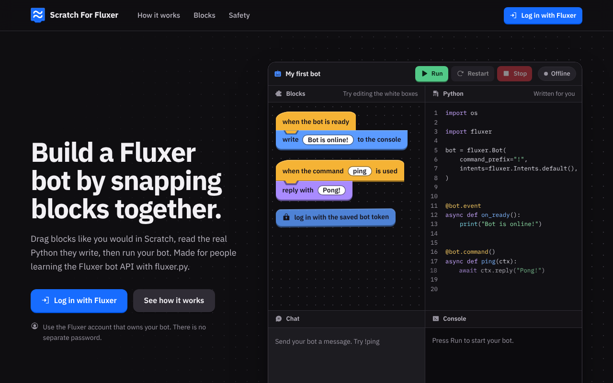
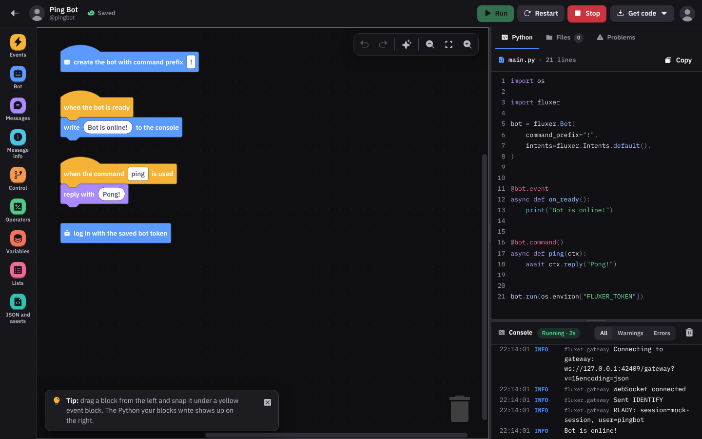

# Scratch For Fluxer

Learn how the Fluxer bot API works by snapping blocks together. Drag blocks the way you would in Scratch, read the real
Python they write (it runs on [fluxer.py](https://github.com/akarealemil/fluxer.py)), then run your bot and watch its console.

[**Join the community server**](https://fluxer.gg/oHy1OzcO) for questions, ideas and blocks you wish existed.





## What is in it

- **A landing page**, **Log in with Fluxer** (OAuth2 with PKCE), a page to **pick or add a bot**, a **paste your bot token**
  step that checks the token with Fluxer, and the **block editor**.
- **79 blocks in 9 families**: Events, Bot (status, custom status, console), Messages, Message info, Control, Operators,
  Variables, Lists, and JSON and assets. Every block writes real fluxer.py code, which you can read, copy or download.
- **Your own files**: upload JSON, images and text files, then pick them from a block's dropdown. The editor shows which
  files your blocks use.
- **Run, Restart and Stop**, with a **console** that shows what the bot prints, plus its logs, warnings and errors.
- **Fluxer's look**: dark surfaces, the logo's blue (`#176dff`) as the accent, IBM Plex type and
  [Phosphor](https://phosphoricons.com) icons in the Fill style only. Everything (fonts, icons, Blockly) is served
  from this site; nothing is loaded from a CDN.
- **Safe by design**: tokens are encrypted, blocks never become arbitrary code, and bots run in a separate process with
  limits (see [Security](#security)).

## How it fits together

```
 browser ──► the website (FastAPI, on Vercel) ──signed, over https──► the runner (a small service) ──► one process per bot ──► Fluxer
                      │
                      └──► Postgres (Neon): accounts, encrypted bot tokens, blocks, uploaded files
```

- **The website** is Python (FastAPI + Jinja2) with plain JavaScript and [Blockly](https://developers.google.com/blockly)
  in the browser. It turns blocks into Python (`scratch_fluxer/compiler.py`), checks that code again (`codecheck.py`),
  and keeps everything in a database.
- **The runner** (`scratch_fluxer/runner/`) is a separate service that keeps bots connected to Fluxer. A bot has to stay
  online all the time, and Vercel only runs short-lived functions, so **bots can't run on Vercel**. You start the runner on
  any machine that can keep a container running ([deploy/runner/README.md](deploy/runner/README.md)). On your own
  computer the website runs the bots itself and you don't need a runner.

## Run it on your computer

You need Python 3.10 or newer.

```bash
git clone <your repository>
cd scratch-for-fluxer
python -m venv .venv
source .venv/bin/activate            # Windows: .venv\Scripts\activate
pip install -r requirements.txt
cp .env.example .env                 # Windows: copy .env.example .env
```

Fill in `FLUXER_CLIENT_ID` and `FLUXER_CLIENT_SECRET` in `.env` (see the next section), then:

```bash
python -m scratch_fluxer check       # looks over your settings and prints what to give Fluxer
python -m scratch_fluxer             # starts the site at http://localhost:8000
```

Open <http://localhost:8000> (not `127.0.0.1`: the address has to be the same as `APP_BASE_URL`, or the login
can't find its cookie). With no `DATABASE_URL` the site uses a SQLite file in `data/`, and with no `SECRET_KEY` it makes
a key for you in `data/.dev-secret`. That is fine on your own computer and nowhere else.

## Set up your Fluxer application (the login)

"Log in with Fluxer" needs an application in Fluxer, with the site's address on its list of redirect URIs.

1. In Fluxer, create an application (the same place you make a bot). Copy its **ID** and its **client secret**. The ID is
   the client ID, so they go into `FLUXER_CLIENT_ID` and `FLUXER_CLIENT_SECRET`. The secret is private: it only ever goes
   in environment variables (`.env` locally, Vercel's settings online), never in code, chat or Git.
2. Add the **redirect URIs** to the application. A Fluxer application can list several (up to 10). The site sends people
   back to `<APP_BASE_URL>/auth/callback`, so add:

   | When                        | Redirect URI                                              |
   | --------------------------- | --------------------------------------------------------- |
   | The live site on Vercel     | `https://your-project.vercel.app/auth/callback`           |
   | On your own computer        | `http://localhost:8000/auth/callback`                     |

   Copy them exactly: same `http` or `https`, same host name, no slash at the end. If you get them wrong, Fluxer
   refuses the login and shows its own error.
3. Run `python -m scratch_fluxer check`. It prints the exact addresses for your settings, and says what is still missing,
   without ever printing a secret. A site that is running also writes the address it expects into its log when it starts.

The site asks Fluxer for the `identify` scope only (your user ID, username, display name and avatar). Fluxer's access
token is used once and given straight back; it is never stored.

## Put it online (Vercel, Neon and a runner)

You need three things: the **website** on Vercel, a **Postgres** database, and a **runner** for the bots.

### 1. The website on Vercel

1. Push this project to a GitHub repository (`.env` and `data/` are in `.gitignore`).
2. On [vercel.com](https://vercel.com), add a new project and import the repository. Vercel finds the FastAPI app
   (`index.py` and `[tool.vercel]` in `pyproject.toml`) and installs `requirements.txt`. `.python-version` asks for
   Python 3.12. The folder `public/` is served by Vercel's CDN.
3. Add a Postgres database: in the project's Storage (or the Marketplace) add **Neon** and connect it to the project. That
   sets `DATABASE_URL`/`POSTGRES_URL` for you. A SQLite file does not survive on Vercel, so the site refuses to start
   without a real database and tells you so.
4. Add these under **Settings → Environment Variables**, then redeploy:

   | Name                   | Value                                                                                   |
   | ---------------------- | --------------------------------------------------------------------------------------- |
   | `SECRET_KEY`           | a long random string: `python -c "import secrets; print(secrets.token_urlsafe(48))"`    |
   | `APP_BASE_URL`         | your site's address, e.g. `https://your-project.vercel.app` (no slash at the end)        |
   | `FLUXER_CLIENT_ID`     | your Fluxer application's ID                                                             |
   | `FLUXER_CLIENT_SECRET` | your Fluxer application's client secret                                                  |
   | `RUNNER_URL`           | the https address of your runner (step 2)                                                |
   | `RUNNER_SECRET`        | the secret you gave the runner, at least 32 characters (step 2)                          |
   | `CONTACT_URL`          | _optional_: `mailto:you@example.com` or a link; shown on the privacy page                 |
   | `COMMUNITY_URL`        | _optional_: another community link, or empty to hide it. Defaults to the project's server |

5. Add `https://your-project.vercel.app/auth/callback` to your Fluxer application's redirect URIs.

Until the settings are right, the site shows an "Almost ready" page that names what is missing instead of crashing.
`/healthz` always answers. Log in on the **production address**: a preview deployment has another address, which is not
on the application's list, so Fluxer would refuse it.

### 2. The runner

The runner needs a machine that can keep a Docker container running. A small VPS is enough to start with. Follow
[deploy/runner/README.md](deploy/runner/README.md): it is one `docker compose up`, then an https address in front of it,
then the two values (`RUNNER_URL`, `RUNNER_SECRET`) on Vercel. Without a runner everything works except the Run button,
which says that running bots isn't switched on.

## All the settings

Every setting is an environment variable (see `.env.example`). Run `python -m scratch_fluxer check` to look yours over.

| Name | Default | What it does |
| ---- | ------- | ------------ |
| `APP_ENV` | `development` | `production` makes the site refuse to start without its secrets. Vercel counts as production. **Set it on any real server.** |
| `SECRET_KEY` | made up locally | Signs login cookies and encrypts bot tokens. At least 32 characters. |
| `SECRET_KEY_PREVIOUS` | empty | Older keys that can still read saved tokens while you change `SECRET_KEY` (comma-separated). See [Changing SECRET_KEY](#changing-secret_key). |
| `APP_BASE_URL` | the request's address (local only) | The site's address with nothing after the host name. Decides the redirect URI. |
| `FLUXER_CLIENT_ID`, `FLUXER_CLIENT_SECRET` | none | Your Fluxer application. Login does not work without them. |
| `DATABASE_URL` | SQLite file in `data/` | A Postgres address (`postgres://` and `postgresql://` both work). |
| `RUNNER_MODE` | `auto` | `auto`, `local`, `remote` or `off`. `auto` uses the runner when `RUNNER_URL` is set, runs bots itself when not on Vercel, and switches running off on Vercel. |
| `RUNNER_URL`, `RUNNER_SECRET` | none | Where the runner is, and the shared secret that signs every call to it. |
| `RUNNER_MAX_CONCURRENT`, `RUNNER_MAX_PER_USER`, `RUNNER_MEMORY_MB`, `RUNNER_MAX_RUN_SECONDS`, `RUNNER_DATA_DIR`, `RUNNER_UID_BASE` | 8, 2, 384, 21600, `data/runs`, none | The runner's limits and where it works. See [deploy/runner/README.md](deploy/runner/README.md). |
| `CONTACT_URL` | none | Shown on the privacy page. `https://`, `http://` or `mailto:` only. |
| `COMMUNITY_URL` | the project's server | The community link in the footer, on the home page and on the privacy page. `https://` only; empty hides it. |
| `TRUST_PROXY`, `TRUSTED_PROXY_HOPS` | off, 1 | Behind your own reverse proxy: believe `X-Forwarded-For`, and how many proxies in a row add an address. Not needed on Vercel. |
| `MAX_BOTS_PER_USER`, `MAX_ASSETS_PER_BOT`, `MAX_ASSET_BYTES`, `MAX_ASSETS_TOTAL_BYTES`, `MAX_WORKSPACE_BYTES` | 10, 40, 2 MB, 8 MB, 1 MB | Limits for one person, one bot and one upload. |
| `FLUXER_API_URL`, `FLUXER_WEB_URL`, `FLUXER_MEDIA_URL`, `FLUXER_STATIC_URL` | Fluxer's own | For a self-hosted Fluxer. |
| `FLUXER_OAUTH_PKCE` | `true` | Sends a PKCE challenge with the login. If Fluxer ever refuses logins because of it, set `false`. |
| `HOST`, `PORT` | `127.0.0.1`, `8000` | For `python -m scratch_fluxer` on your computer. |

### Changing SECRET_KEY

Everything the site encrypts or signs depends on `SECRET_KEY`, so change it in this order:

1. Put the **new** key in `SECRET_KEY` and the **old** one in `SECRET_KEY_PREVIOUS`, then deploy.
   Everybody is logged out once, because login cookies are signed with the key. Saved bot tokens still work: each
   one is saved again under the new key the first time its bot runs.
2. To do all of them at once, run `python -m scratch_fluxer reencrypt` with the same settings (`DATABASE_URL` and the two
   keys). `--dry-run` only counts. It is safe to run again, and while the site is in use. It never prints a token or a key.
3. When it says every token is under the newest key, remove `SECRET_KEY_PREVIOUS`.

If a key is lost for good, its tokens can't be read. The owner is asked to paste the token again.

## Your logo

The logo is `public/static/img/logo.png`. To use another, replace that file with a transparent PNG, then run:

```bash
pip install -r requirements-dev.txt
python scripts/make_icons.py                 # the favicon, the app icons
python scripts/make_og.py                    # the link-preview image (needs Playwright with Chromium)
```

## Security

The short version, for people who are about to type a bot token into a website:

- **Bot tokens** are encrypted before they are stored (Fernet: AES-128-CBC with an HMAC, with a key derived from
  `SECRET_KEY`). The browser is never sent a token back, not even encrypted. The last four characters are kept in the
  clear so you can tell tokens apart. The token is decrypted for the length of one request when a bot starts, and lives in
  that bot's process after that. **No block can read it**, and the generated code only ever reads it from an environment
  variable.
- **Login** keeps no Fluxer token. Sessions are signed cookies (`HttpOnly`, `SameSite=Lax`, `Secure` online) that also
  carry a counter in the database, so logging out signs you out on every device and a copied cookie stops working.
- **Requests**: every change needs a CSRF token and a same-origin check, a person only ever reaches their own bots (someone
  else's id looks like a bot that doesn't exist), inputs are size-limited, and there are rate limits. The page's
  Content-Security-Policy forbids inline scripts, and the site's own JavaScript never builds HTML from strings (a test
  enforces that).
- **Blocks are not code.** The compiler only writes what its catalogue allows; text a person types is always written as
  a string, never as code. The result is checked again by an allow-list over its syntax tree, once when it is built and
  once more just before a bot starts. Anything else is refused.
- **Bots run apart**: each in its own process, in its own folder, from a clean environment, with limits on memory, processor
  time, file size, open files, processes, time and output. With the runner image each bot also runs as a different user
  with no capabilities. Details and what you must do yourself (network rules) are in
  [deploy/runner/README.md](deploy/runner/README.md).
- **Delete my data** on the My bots page removes the account, every bot, token, block layout and file, and stops running bots.

## Status and known limits

Read this before you rely on it. It says what was checked and what could not be.

- **Python versions.** The whole test suite (about 4,000 tests, the browser tests included) passes on Python 3.13, and
  everything except the browser tests passes on 3.10, 3.11 and 3.12. The runner's image and Vercel use 3.12.
- **Tested against pretend servers.** The login, the token check and the bots' connection to Fluxer were tested against
  mock servers shaped like Fluxer's documented API. They could not be tried against the real Fluxer from where this was
  built. Your first real run (log in, add a token, press Run) is the real test. Three things rest on documentation and
  fluxer.py's behaviour rather than a real run: the shape of the *custom status* update, the *member joined/left* events,
  and the `bot._gateway` call used for the custom status.
- **The "only add your own bot" check** relies on Fluxer sending the application's owner. If it doesn't, the check is
  skipped and logged. Knowing a bot's token is already full control of that bot, so this is a guard-rail rather than a wall.
- **The Docker image was not built here.** The runner's code and the isolation were tested with real processes and
  with the same capabilities the container has, but the `Dockerfile` and `docker-compose.yml` were only checked for
  syntax. Build it and run `curl http://127.0.0.1:8080/healthz` before you trust it.
- **Vercel was not deployed to.** The setup follows Vercel's documented FastAPI support, but it hasn't been run on Vercel.
- **Network rules are yours to set.** A bot can reach whatever its container can reach. If you run other things on that
  network, block private ranges and the cloud metadata address from the runner (see the runner README).
- **A bot that gets past the code check** (there is no known way) would find the runner's disk limit shared between bots.
  Run the runner with a size-limited folder, as the compose file does.
- **Review.** An automated security review of the website and its API was done and its findings were fixed. The compiler
  and runner got the project's own tests and attack-style tests (thousands of random and deliberately damaged inputs),
  but no independent review.
- **SQLite is for working on your own computer.** It does one piece of database work at a time. Use Postgres online.
- **No licence is set yet.** Add a `LICENSE` file before you let others copy or contribute. Third-party licences are in
  [THIRD_PARTY_NOTICES.md](THIRD_PARTY_NOTICES.md).

## Troubleshooting

| You see | Why, and what to do |
| ------- | ------------------- |
| An error page from **Fluxer** when you press Log in | The redirect URI isn't on your application's list, or isn't written exactly the same. Run `python -m scratch_fluxer check`, copy the address it prints. |
| "Your login session expired or didn't match" | Cookies were blocked, or you opened the site at a different address than `APP_BASE_URL` (`127.0.0.1` instead of `localhost`, say). |
| "Fluxer didn't accept the login" | The client ID or secret is wrong. If those are right, try `FLUXER_OAUTH_PKCE=false`. |
| An **"Almost ready"** page | Production settings are missing. It lists them. |
| "Running bots isn't switched on" | The site has no runner: set `RUNNER_URL` and `RUNNER_SECRET` (the secret needs 32 characters), or run locally. |
| "The runner no longer has this run" | The runner was restarted, which stops every bot. Press Run. |
| "The saved token can't be read any more" | `SECRET_KEY` was changed without `SECRET_KEY_PREVIOUS`. Put the old key back there, or paste the token again on My bots. |
| The site shows everybody as one visitor / "Too many requests" | Behind a reverse proxy, set `TRUST_PROXY=1`. |

## Working on the project

```bash
pip install -r requirements-dev.txt
playwright install chromium                       # only for the browser tests
pytest                                            # everything
pytest -m "not browser and not e2e"               # the quick part (no browser, no bot processes)
ruff check . && ruff format --check .
```

- `scratch_fluxer/` – the site: `compiler.py` and `catalogue.py` (blocks to Python), `codecheck.py` (the allow-list),
  `security.py`, `routes/`, `templates/`, and `runner/` (the service that runs bots).
- `public/static/` – the front end: `js/editor/` is the editor, `vendor/` holds Blockly and the icon font.
- `deploy/runner/` – the runner's Dockerfile, compose file and guide.
- `tests/` – the tests, a pretend Fluxer (`fluxer_mock.py`, `mock_fluxer_server.py`) and the random-program tester
  (`fuzz_blocks.py`, which works out what each random bot should do without using the compiler).

Block catalogue first: a block is defined once in `catalogue.py` and the compiler, the editor, the landing page and the
tests all read it, so a new block is mostly an entry there plus the code it writes in `compiler.py`.

Fluxer and its name belong to their owners.
